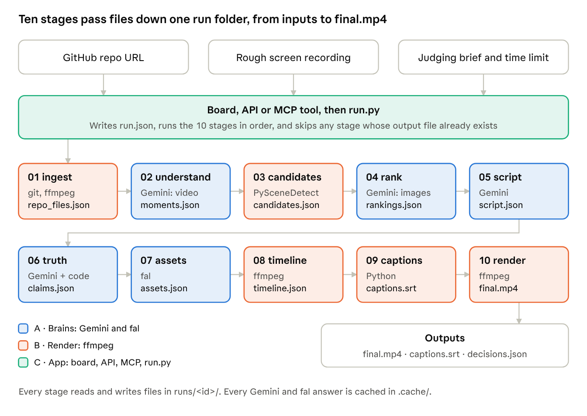

# DemoCut

**A rough recording of your app + its GitHub repo + the judging brief → a short launch video cut from the real footage.**

Gemini watches the recording and decides what to show. fal makes the voice, music and title cards, and
ffmpeg does the cutting. DemoCut edits your footage rather than generating new footage: almost every frame
comes from the recording, and a truth check stops the voice-over from claiming anything the repo or footage
can't back up. Nobody touches the final video by hand. To change it, edit the prompts or code and re-run.

## Who it's for and why

DemoCut is for anyone who has built something and has to show it: hackathon teams in their last hours,
founders shipping a launch, open-source maintainers cutting a release.

**The problem.** The demo video is the part of a project most people see, and the part most teams have the
least time to make. Cutting a take, writing a voice-over and making title cards eats the last hours before
a deadline.

**The solution.** Give DemoCut a rough recording of your app, its GitHub repo and the judging brief. It cuts
a short launch video from your real footage, and checks every claim in the voice-over against the footage
or the repo before it is spoken.



## Quick start

Needs **Python 3.11+** and **ffmpeg 5+** built with libass and freetype.

```bash
python -m venv .venv
source .venv/bin/activate          # Windows: .venv\Scripts\activate
pip install -r requirements.txt
cp .env.example .env               # fill in GEMINI_API_KEY, GEMINI_MODEL, FAL_KEY
pytest -q
```

**No keys yet?** Fake mode copies each stage's output from `fixtures/run/` instead of calling Gemini, fal or ffmpeg:

```bash
DEMOCUT_FAKE=all uvicorn backend.app:app   # open http://127.0.0.1:8000
```

## Making a video

All three ways start the same pipeline (`backend/run.py`) in its own process.

### 1. The board (browser or phone)

```bash
python -m backend.serve            # prints the LAN address and a QR code, checks your keys
python -m backend.serve --tunnel   # also an https link via cloudflared, for Wi-Fi that isolates devices
```

Open the address, or scan the QR code with your phone. There are three steps: the repo, the recording
(up to **10 min per video, 5 GiB together**), then the brief. You watch each stage run live and get the video with Download
and Share. Alongside it, the board shows how each choice was made: real vs generated shots (target ≥ 50%
real), claims kept or rejected, ranked frames and hooks, and the final rubric check. `/#<run_id>` opens a
past run.

- **Uploads** go in 4 MB parts. If the connection drops, the upload resumes after a reload when you pick
  the same file again. Each upload is logged to `runs/_uploads/<id>.log`.
- **Keys:** *⚙ Settings* on the laptop (`localhost` only) saves the Gemini, fal and GitHub keys to `.env`.
  They apply from the next run without a restart and are never shown again.
- **GitHub login (optional):** create an OAuth app at https://github.com/settings/developers with the
  callback `http://localhost:8000/auth/github/callback` (on a phone, use the laptop's IP instead of
  `localhost`). Then set `GITHUB_CLIENT_ID` and `GITHUB_CLIENT_SECRET`. Step 1 then lists your repos.
  Add `repo` to `GITHUB_OAUTH_SCOPES` for private repos. The token stays in server memory and reaches a
  run only as `GITHUB_TOKEN`.
- Over plain `http`, phones can't *Install* the board as an app, and *Share* copies the link instead.
  Upload and playback still work.

### 2. Command line

```bash
python -m backend.run                              # new run from the fixture recording
python -m backend.run runs/<run_id>                # run, or resume, a run
python -m backend.run runs/<run_id> --only script  # redo one stage
python -m backend.stats runs/<run_id>              # time taken, claims rejected, real-footage share
```

### 3. Claude Code (MCP)

```bash
claude mcp add democut -- "$PWD/.venv/bin/python" -m backend.mcp_server
# Windows: claude mcp add democut -- "%CD%\.venv\Scripts\python.exe" -m backend.mcp_server
```

Then ask: *"make a demo video of github.com/you/app from ~/Desktop/take.mov"*. Claude calls
`make_demo_video`. Repeating the same request returns the cached result for free. `demo_video_status`
checks on a run started with `wait: false`.

## How it works

Each stage is one file in `backend/pipeline/` with a `run(run_dir, cfg)` function. A stage reads earlier
files in `runs/<run_id>/` and writes its own. **Files are the interface:** stages never call each other,
and every file has a Pydantic model in [`backend/contracts.py`](backend/contracts.py).

| # | Stage | Uses | Writes |
|---|---|---|---|
| 1 | ingest | git, ffmpeg | `repo_files.json`, `audio.wav`, `screenshots/` |
| 2 | transcribe | fal | `transcript.json` |
| 3 | understand | Gemini (video) | `summary.json`, `moments.json` |
| 4 | candidates | PySceneDetect, ffmpeg | `candidates.json`, `frames/` |
| 5 | judge_frames | Gemini (images) | `frame_scores.json`, `decisions.json` |
| 6 | script | Gemini + code | `script.json` (hooks, shots, checked claims) |
| 7 | assets | fal | `assets.json`, `voice/`, `music.wav`, `cards/` |
| 8 | timeline | Python | `timeline.json` |
| 9 | rubric | Gemini | `decisions.json` (final check; may ask for one recut) |
| 10 | captions | Python | `captions.srt`, `captions.ass` |
| 11 | render | ffmpeg | `shots/`, `final.mp4` |

- **Truth check:** every factual claim in the voice-over needs evidence: a stretch of footage, a README
  section or a repo file. Code verifies the quotes, not the model. A claim without evidence is rewritten
  to match what the evidence shows, or dropped.
- **No recording:** ingest looks for a live URL (the repo homepage, then links in the brief, then the
  README) and records the site itself in headless Chromium, with Gemini driving the clicks. No repo code
  is run. If there's no URL, the video is made from the repo alone.
- **Resume:** run the same command again and a failed run continues from the last finished stage.
  Delete a stage's output, or use `--only`, to redo that stage.
- **Cache:** every Gemini and fal answer is stored in `.cache/`, keyed by the request and the content of
  its files. Repeat runs cost nothing and only re-render.
- **Languages:** `en` and `el`, plus an optional second caption/voice language. **Modes:** `cheap`
  (plain cards, fewer judge calls) or `full` (best of 4 cards, music, full judging).

## Configuration

| Variable | What |
|---|---|
| `GEMINI_API_KEY`, `GEMINI_MODEL` | Gemini key ([get one](https://aistudio.google.com/apikey)) and model id |
| `FAL_KEY` | fal key ([get one](https://fal.ai/dashboard/keys)) |
| `GITHUB_CLIENT_ID`, `GITHUB_CLIENT_SECRET`, `GITHUB_OAUTH_SCOPES` | Optional GitHub login |
| `DEMOCUT_FAKE` | `all`, or a comma list of stages to fake from `fixtures/run/` |
| `DEMOCUT_NO_CACHE=1` | Ignore stored answers |
| `DEMOCUT_CACHE` | Cache folder (default `.cache/`) |
| `DEMOCUT_AUTORECORD=0` | Don't record the live site when there's no recording |
| `DEMOCUT_CHROMIUM` | Browser binary for auto-recording |

## API

| Method | Path | What |
|---|---|---|
| `GET` | `/` | The board |
| `POST` | `/uploads` | Start a resumable upload (`{filename, size}`) |
| `PUT` | `/uploads/{id}?offset=N` | Send one part (raw bytes); a wrong offset returns 409 |
| `GET` | `/uploads/{id}` | Bytes received so far |
| `POST` | `/runs` | Start a run. Form fields: `repo_url`, `upload_id` or `recording`, `brief_text`, `criteria`, `time_limit_s`, `language`, `second_language`, `mode` |
| `GET` | `/runs` | List runs, newest first |
| `GET` | `/runs/{id}` | Status, config, finished stages |
| `GET` | `/runs/{id}/events` | Live progress (Server-Sent Events) |
| `GET` | `/runs/{id}/files/{path}` | Any run file, e.g. `final.mp4` |
| `GET` | `/auth/github/login`, `/auth/me`, `/github/repos` | GitHub login, current user, their repos |

## Repo layout

```
backend/
  run.py          orchestrator: stage order, fake mode, resume, --only
  app.py          FastAPI server and board routes
  serve.py        LAN/tunnel launcher with QR code
  mcp_server.py   make_demo_video tool for Claude Code
  contracts.py    one Pydantic model per run file
  cache.py        .cache/ for Gemini and fal answers
  clients/        Gemini and fal clients
  pipeline/       one file per stage (+ autorecord)
  prompts/        the Gemini prompts
web/              the board: one HTML page, plain JS, no build step
fixtures/run/     a complete example run (made-up app "PantryPal")
samples/          test recordings
tests/            pytest suite (tests/recordings/ = recorded model answers)
docs/             RUNBOOK.md (plan and tickets), PITCH.md
```

## Team

| | Owns |
|---|---|
| A · Brains | Gemini and fal clients; understand, judge, script, assets, prompts |
| B · Render | ffmpeg helpers; ingest, candidates, timeline, captions, render, autorecord; fonts |
| C · App and pitch | run.py, events, cache, API, MCP server, board, samples, README, slides |

Built in 20 hours at a hackathon, Nov 14–15, 2026.
