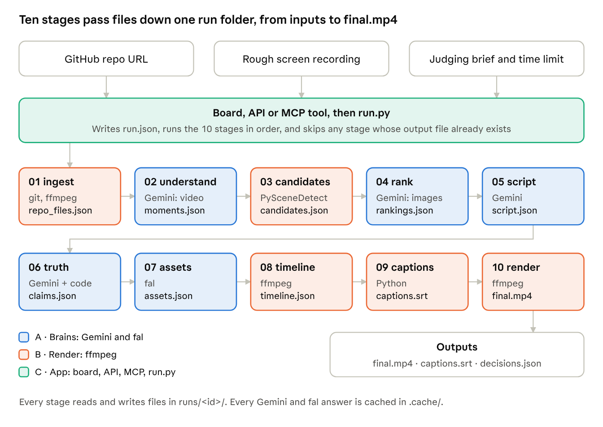

# DemoCut Runbook

Nov 14, 2026 · @thanos

## What we're building

DemoCut turns a GitHub repo, one rough screen recording and the judging brief into a 2–3 minute
demo video, cut from the real footage. Gemini decides what to show, fal makes the voice, music and
title cards, and ffmpeg cuts it. We are an editor, not a generator: almost every frame is real footage.

Start Sat 22:00. Code freeze Sun 18:00. The starter code is in `democut-starter.zip`; full code and
fixtures are on the DemoCut Architecture page.

**Languages:** for now everything is Greek and English only (`en`, `el`): voice, captions, cards, prompts.

## Golden rules

1. **Own your files.** Only edit files in your column of the ownership table. Need a change in
   someone else's file? Ask them.
2. **Files are the interface.** Each stage reads and writes JSON in `runs/<id>/`. Test your stage
   against `fixtures/`, never wait for a teammate.
3. **Contracts are frozen after 23:00.** Changing a JSON field means telling the other two first.
4. **Small commits to `main`, often.** Pull before you push. No long branches tonight.
5. **Re-run, never hand-edit the video.** The pitch line "nobody edited this" must stay true.

## Tech stack

Python does everything except the board, which is one plain HTML page. No React, no Remotion, no database.

| Layer | Tool | Why |
|---|---|---|
| Language | Python 3.11+ | One language for the whole team |
| Brains | Gemini via `google-genai`, current Flash model | Watches video, reads images, returns JSON to a schema |
| Media | fal via `fal-client` | Voice, music, title cards, transcription; fal track |
| Video | ffmpeg 5+ with libass and freetype | Cut, fit, caption, mix, render |
| Scene cuts | PySceneDetect (`scenedetect`) | Snaps Gemini's timestamps to real cuts |
| API | FastAPI + uvicorn, events streamed with SSE | Starts runs, streams progress, serves files |
| Board | One `web/index.html`, plain JavaScript | Upload, progress, player; no build step |
| Agent tool | `mcp` 2.x (`MCPServer`) | `make_demo_video` for Claude Code |
| Storage | Plain files in `runs/<id>/`, cache in `.cache/` | Resume any run; re-runs cost nothing |
| Repo | One GitHub repo, everyone on `main` | Fewest moving parts |

## How the pieces connect

The board, the API and the MCP tool all start the same thing: `run.py`, which runs ten stages in order.

Inputs: GitHub repo URL · rough screen recording · judging brief and time limit
→ **Board, API or MCP tool, then `run.py`** (C): writes `run.json`, runs the 10 stages in order,
and skips any stage whose output file already exists.

| # | Stage | Owner | Tool | Writes |
|---|---|---|---|---|
| 01 | ingest | B | git, ffmpeg | `repo_files.json` |
| 02 | understand | A | Gemini: video | `moments.json` |
| 03 | candidates | B | PySceneDetect | `candidates.json` |
| 04 | rank | A | Gemini: images | `rankings.json` |
| 05 | script | A | Gemini | `script.json` |
| 06 | truth | A | Gemini + code | `claims.json` |
| 07 | assets | A | fal | `assets.json` |
| 08 | timeline | B | ffmpeg | `timeline.json` |
| 09 | captions | B | Python | `captions.srt` |
| 10 | render | B | ffmpeg | `final.mp4` |

Outputs: `final.mp4` · `captions.srt` · `decisions.json`. Every stage reads and writes files in
`runs/<id>/`. Every Gemini and fal answer is cached in `.cache/`.

> Note: the repo's `backend/contracts.py` and `fixtures/run/` define the frozen file contracts
> (11 stages: ingest, transcribe, understand, candidates, judge_frames, script, assets, timeline,
> rubric, captions, render). Where this table differs, the contracts win.

Each stage is one Python file with a `run(run_dir, cfg)` function. It reads the files before it and
writes one new file; that file existing means the stage is done.

## Who owns which files

No file has two owners, so three people can push to `main` all night without merge conflicts.

| Person | Owns (only they edit) | Writes in each run | Reads from others |
|---|---|---|---|
| A · Brains | `backend/clients/gemini.py`, `backend/clients/fal.py`, `backend/pipeline/understand.py`, `judge.py`, `script.py`, `assets.py` | `summary.json`, `moments.json`, `transcript.json`, `rankings.json`, `script.json`, `claims.json`, `assets.json`, `decisions.json` | `repo_files.json`, `candidates.json` (B) |
| B · Render | `backend/pipeline/ff.py`, `ingest.py`, `candidates.py`, `timeline.py`, `captions.py`, `render.py`, `fonts/` | `repo_files.json`, `candidates.json`, `timeline.json`, `captions.srt`, `final.mp4` | `moments.json`, `script.json`, `assets.json` (A) |
| C · App and pitch | `backend/run.py`, `events.py`, `cache.py`, `app.py`, `mcp_server.py`, `web/`, `samples/`, `README.md`, slides | `run.json`, `events.jsonl` | Everything, read only |
| Shared | `fixtures/`: change only after telling the other two | | |

## Tickets · A · Brains (Gemini and fal)

A makes every decision and every generated asset. Test each stage alone with
`python -m backend.run runs/dev --only <stage>`.

| ID | Ticket | Done when | By | Status |
|---|---|---|---|---|
| A1 | Keys and clients: `gemini.py`, `fal.py` | One Gemini JSON call and one fal voice call both return | 23:00 | To do |
| A2 | Check fal field names for scribe, voice, FLUX 2, Nano Banana 2, music | Every line marked *check field names* fixed | 00:00 | To do |
| A3 | `understand.py`: summary and moments | `moments.json` from the test take, on-screen text copied word for word | 01:30 | To do |
| A4 | Voice in `assets.py` | One MP3 per shot from fixture `script.json`, lengths in `assets.json` | 02:00 | To do |
| A5 | `script.py` and the hook pick | `script.json` from real moments, uses only real moment ids, one hook chosen | 04:00 | To do |
| A6 | `judge.py`: ranking and truth check | `rankings.json`; `claims.json` with quotes verified by code; failed claims rewritten | 05:30 | To do |
| A7 | Title cards and music | Best of 4 cards picked by the judge; plain cards in cheap mode; music bed | 11:00 | To do |
| A8 | Zoom boxes (should have) | One call per chosen frame writes a zoom box into `script.json` | 11:00 | To do |
| A9 | Our own video | Version 1 at 12:00; fixes only through prompts or code; version 2 by 14:00 | 14:00 | To do |

## Tickets · B · Render (ffmpeg)

B turns decisions into pixels. B needs no keys until B4, so B can start immediately.

| ID | Ticket | Done when | By | Status |
|---|---|---|---|---|
| B1 | Setup: ffmpeg 5+, font, fake media | `scripts/make_fake_media.sh` runs; `NotoSans-Bold.ttf` in `fonts/` | 23:00 | Done |
| B2 | Render half on fixtures | timeline → captions → render gives `runs/dev/final.mp4` | 23:30 | To do |
| B3 | Render on the real test take | Works on C's take in `samples/`, whatever its size and frame rate | 00:30 | To do |
| B4 | `ingest.py` | Clones a real repo; `repo_files.json`; `audio.wav` when the take has sound | 01:00 | To do |
| B5 | `candidates.py` | Scene cuts and 3 frames per moment from A's `moments.json` | 02:00 | To do |
| B6 | Checkpoint 1, with A | Test take + fixture script + real voices → captioned MP4 | 02:00 | To do |
| B7 | First full run, with A, then speed | A full run takes under 15 minutes; add a 720p preview mode if not | 05:30 | To do |
| B8 | Robustness | Handles no audio, very short or long moments, a failed fal call; resumes mid-run | 09:00 | To do |
| B9 | Final video | Version 1 checked frame by frame, bugs fixed, version 2 uploaded | 15:30 | To do |

## Tickets · C · App, board, MCP and pitch

C builds what people see and owns the story. C sets up the repo first, so A and B can clone it.

| ID | Ticket | Done when | By | Status |
|---|---|---|---|---|
| C1 | Repo from the starter zip | GitHub repo up, A and B invited, `.env` template, `.gitignore` | 22:15 | To do |
| C2 | Test take | Rough 3-minute recording of any app in `samples/`, with its repo URL | 23:00 | To do |
| C3 | Orchestrator and API | `POST /runs` starts a run; `/runs/{id}/events` streams a fixture run | 00:30 | To do |
| C4 | Board | `web/index.html` uploads, shows progress, plays `final.mp4` | 01:30 | To do |
| C5 | MCP tool | `make_demo_video` listed in Claude Code and returns a cached run | 02:00 | To do |
| C6 | Board shows the decisions | Rankings, rejected claims and facts from `decisions.json` | 08:00 | To do |
| C7 | DemoCut's own take | Rough 4-minute recording of DemoCut in use | 10:00 | To do |
| C8 | 20-second test | 5–10 people: our cut vs a video another team made by hand | 13:00 | To do |
| C9 | Pitch, slides, README | 3-minute script, 3 slides, cached live demo; manual OBS video by 15:00 if checkpoint 3 fails | 14:00 | To do |

## Make runs fast

A run's time goes to Gemini, fal and ffmpeg, not to Python, so these five changes matter more than the language.

| # | Do this | Who | When |
|---|---|---|---|
| 1 | **Run fal calls in parallel.** In `assets.py`, run voice, card and music calls 4–8 at a time with a thread pool instead of one by one. Biggest single saving. | A | With A4 |
| 2 | **Cache everything.** Already in `cache.py`: a repeat run of the same take costs nothing and only re-renders. Never clear `.cache/` before the pitch. | All | Always |
| 3 | **Cheap mode while developing.** Plain cards, no best-of-4; switch to full mode only for real runs. | All | Until 11:00 |
| 4 | **720p previews.** A preview flag in `ff.py` that scales to 1280×720, about half the encode time. 1080p for the final video only. | B | With B7 |
| 5 | **Short test takes.** Use a 1-minute take while debugging; the full 3–4 minute take only at the checkpoints. | C | From C2 |

## Timeline, Sat 22:00 to Sun 18:00

Three checkpoints decide what gets cut. Each person sleeps once, staggered, so two people are always building.

| Time | A · Brains | B · Render | C · App and pitch |
|---|---|---|---|
| 22:00–23:00 | A1 | B1 | C1, C2 |
| 23:00–02:00 | A2, A3, A4 | B2, B3, B4, B5 | C3, C4, C5 |
| **02:00 · Checkpoint 1** | Test take + fixture script + real voices → captioned MP4. Fails: A and B pair on it; music waits. | | |
| 02:00–05:30 | A5, A6 | B6, B7 | Sleep |
| **05:30 · Checkpoint 2** | Repo URL + test take → board → MP4, no hand steps, under 20 min. Fails: cheap mode, plain cards, fix speed before features. | | |
| 05:30–09:00 | Sleep | B8 | C6 |
| 09:00–11:00 | A7, A8 | Sleep until 12:00 | C7 at 10:00, start C8 |
| **11:00 · Feature freeze** | Only fixes from here. | | |
| 11:00–14:00 | A9 | B9 from 12:00 | C8, C9 |
| **14:00 · Checkpoint 3** | Version 2 is the submission, or C finishes a manual OBS video by 15:00. | | |
| 14:00–15:30 | README with architecture | Upload the video early | Rehearse |
| 15:30–16:30 | All: submit repo, video and details | | |
| 16:30–17:30 | All: rehearse the pitch 3 times, test the projector | | |
| 17:30–18:00 | Buffer | | |

**Cut order when a checkpoint fails:** animated zoom and B-roll first, then best-of-4 cards (use plain
cards), then music, then the MCP tool. Never cut the truth check: it is the pitch.

## Pitch: 3 minutes

Open on the video itself, then reveal that nobody edited it.

| Time | Beat | What's on screen |
|---|---|---|
| 0:00–0:15 | Our submission video | First 15 seconds, full screen |
| 0:15–0:30 | The pain | "Every team here spent its last hours on this video." |
| 0:30–0:50 | Reveal | Raw take next to the final cut; time and cost to make it |
| 0:50–1:40 | How it works | Cached run on the board: moments ranked, one claim rejected |
| 1:40–2:00 | Proof | 20-second test result and time to video |
| 2:00–2:25 | Agents can call it | Claude Code calls `make_demo_video` on a cached run |
| 2:25–3:00 | Close | Who needs it next: every hackathon, launch and open-source release |

**Numbers to measure:** wall-clock time from repo URL to MP4, human minutes spent, fal cost per video,
claims made vs rejected, and the 20-second test score.

**Questions to rehearse:**

- *"How is this different from Proof & Demo?"* It's hands-off from one take, an agent can call it,
  and fal generates takes the judge chooses between.
- *"Isn't this just Higgsfield?"* No: Higgsfield generates new pixels; DemoCut edits your real
  footage and won't let the video claim what the product can't do.

## When things break

| Problem | Quick fix |
|---|---|
| A run failed halfway | Fix it and run the same command again; it resumes from the last finished stage |
| One stage is wrong | Delete that stage's output file, then `--only <stage>` |
| Gemini rate limit | Wait; calls retry with back-off and are cached, so nothing is paid twice |
| A fal output field is wrong | Print the result once, fix the marked line in `assets.py` |
| No fal at all | Cheap mode: plain cards, no music; the video still renders |
| Gemini timestamps look off | Check `candidates.json`; they snap to scene cuts within 1.5 s |
| The join fails | A shot is missing audio or has another frame rate; every shot must go through `render.shot()` |
| Captions show boxes instead of letters | The font in `fonts/` is missing or has no Greek letters |
| Merge conflict | Someone edited a file they don't own; the owner's version wins |
| Stuck for 30 minutes | Say it out loud, then cut the feature using the cut order above |
